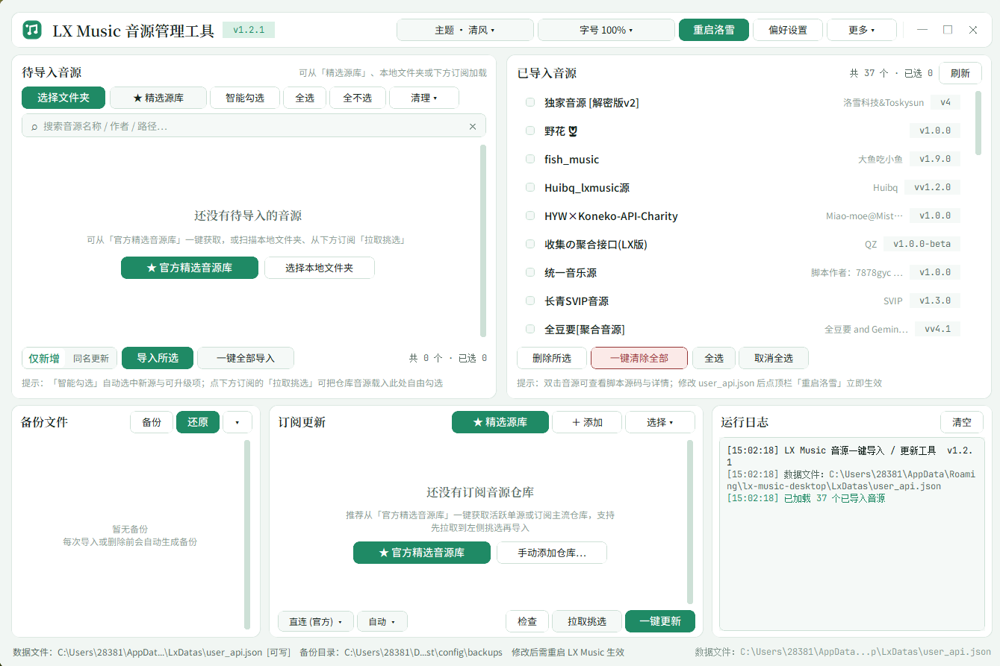

# LX Music 音源一键导入 / 更新工具

针对 [lx-music-desktop](https://github.com/lyswhut/lx-music-desktop)（洛雪音乐桌面版）的自定义音源批量管理工具，带图形界面，一站式完成音源的导入、更新、挑选、备份、还原与清除。

> 本工具只是一个非官方开源爱好者制作的本地管理工具，不内置、不提供、不分发任何音源脚本。
>
> 自用，使用 AI 辅助开发。本项目与洛雪音乐（lx-music-desktop）官方、Anthropic（Claude）、DeepSeek（深度求索）无任何关联。

## 功能

- **自动定位数据文件**：自动定位 `user_api.json`（找不到可手动重新定位），一键打开数据目录
- **本地文件夹递归扫描**：选择文件夹后递归识别所有 `.js` 音源，并自动解析脚本头部的 `@name / @version / @description / @author / @homepage` 元数据
- **待导入音源列表与状态对比**：
  - 自动对比本地已安装音源，显示 `★ 新源` / `↑ 升级` / `= 同版` / `↓ 旧版` 状态胶囊角标
  - 支持「**智能勾选**」（只勾选新音源和可升级版本，自动跳过已装同版或低版本）、全选、反选、搜索过滤、移除所选（仅移出列表，不删除磁盘文件）
- **两种导入模式**（左卡底部胶囊拨片切换）：
  - **仅新增（导入模式）**：直接追加新增（内容完全相同自动跳过）
  - **同名更新（更新模式）**：按音源名称自动匹配，同名覆盖更新（保留原 `id`），无同名则新增
- **已导入音源管理**：查看已安装音源（名称 / 版本 / 作者 / 描述 + 脚本详情预览）、历史版本切换、删除所选、一键清除全部
- **备份管理**：手动生成备份、一键还原备份、查看 / 删除 / 清空；所有写入或删除操作前自动备份
- **GitHub 订阅与精选音源库**：
  - **★ 精选源库（双分区）**：
    - **上半区 · 热门单源直链（免订阅 · 多镜像自动回退）**：内置 7 条主流单源加速直链（默认预勾「黄金三件套」），支持 `ghproxy.net` / `gh.llkk.cc` / `gh-proxy.org` / `ghfast.top` 自动回退，可选择「**拉取到待导入列表自由挑选**」或「**一键直接导入**」
    - **下半区 · 活跃音源仓库（添加长期订阅）**：内置主流长期维护的音源仓库，一键勾选加入订阅列表，已订阅项自动置灰跳过
  - **拉取挑选 vs 一键更新**：
    - **拉取挑选**：将订阅仓库的最新音源下载解压并放入左侧「待导入音源」候选列表，配合「智能勾选」自由挑选想要安装的音源，不强制全量写入
    - **一键更新 / 更新所选**：勾选指定订阅（或全部订阅）直接下载并以同名更新模式导入
  - **两种订阅来源**：**Release 附件**（`.js` / `.zip`）或 **仓库目录**（直接读取仓库指定目录下的 `.js`，可指定子目录与分支）
  - **行内版本对比**：检查更新后直接显示 `已装 vX → 最新 vY` 及 `↑ 有新版` / `✓ 最新` 状态角标
  - **多下载器与实时进度条**：支持 **自动 / 内置 / IDM / AB Download Manager（ABDM）**，自动模式依次回退；内置下载在底部状态栏实时显示进度条与已下载体积
  - **支持加密压缩包**：自动解压 `.zip` 附件并在解压后清理原压缩包；遇到加密 zip 弹窗输入一次密码即可在会话内自动记忆
- **历史版本归档与切换**：更新订阅时旧版本自动归档到 `history/<版本>/`，列表默认只保留最新版本；右键「待导入音源」或「已导入音源」即可在历史版本之间随时切换
- **一键重启洛雪 & 检查工具更新**：
  - 顶栏「**重启洛雪**」：自动结束并重新拉起 `lx-music-desktop.exe` 使新音源立即生效
  - 顶栏「**检查更新**」：比对本工具 GitHub Release，发现新版本可直接下载
- **个性化外观与高分屏适配**：
  - **一体化无原生标题栏窗口**：保留 Windows 11 原生圆角阴影、任务栏洛雪图标、顶栏拖拽与双击工作区最大化
  - **四套实时主题配色**（顶栏 `主题 ▾` 或设置页一键切换，无需重启，左上角徽章同步切换，任务栏与 EXE 图标固定为洛雪风格图标）：
    - **清风（洛雪）**（默认）
    - **暖砂（类Claude）**
    - **鲸蓝（类Deepseek）**
    - **星月（暗夜）**
  - **界面字号实时缩放**：顶栏 `字号 ▾` 支持 `90% ~ 180%` 多档预设（设置页滑块支持 `85% ~ 200%`），针对 1080p / 2.5K / 4K 与 150% DPI 屏幕深度优化
- **配置集中存放**：所有配置、字体缓存、日志与备份均存放在程序目录的 `config/` 文件夹内，绿色不散落

## 界面预览



## 使用

方式一：运行源码

```bash
pip install customtkinter pillow
python LXmusic一键导入和更新.py
```

方式二：打包为独立 exe

```bash
pip install pyinstaller customtkinter pillow
pyinstaller --noconfirm --clean --onefile --windowed --icon "lx_icon.ico" --collect-all customtkinter --name "LXmusic一键导入和更新" LXmusic一键导入和更新.py
```

生成结果在 `dist` 目录。

## 目录结构

```text
<程序目录>/
├── LXmusic一键导入和更新.py / .exe
└── config/                # 全部配置集中存放
    ├── settings.json      # 应用设置（主题、字号、镜像、下载方式、备份、日志…）
    ├── subscriptions.json # 订阅列表
    ├── backups/           # 备份文件（可在设置中修改位置）
    └── logs/app.log       # 运行日志
```

订阅下载目录（默认在系统下载文件夹下的 `lxsubscribe`，可在设置中修改）：

```text
<下载目录>/
└── <owner>/<repo>/
    ├── (最新版本的 .js 音源)
    └── history/<版本>/    # 历史版本归档，可在界面右键切换
```

## 注意事项

- 修改 `user_api.json` 后需重启 LX Music 桌面版才会生效（可直接点击顶栏「重启洛雪」）。
- 脚本以官方格式（`gz_` + `zlib` + `base64`）压缩存储。
- 操作无需管理员权限。
- 订阅下载的脚本会被 LX Music 直接执行，请只订阅可信仓库。

## 免责与非官方版权声明

1. **非官方爱好者作品声明**：本项目是由个人开源爱好者独立开发的非官方辅助管理工具，仅用于个人学习与技术交流。**本项目与 [lx-music-desktop（洛雪音乐）](https://github.com/lyswhut/lx-music-desktop) 官方团队、Anthropic PBC（Claude）、杭州深度求索人工智能基础技术研究有限公司（DeepSeek）及任何其他第三方公司或组织均无任何官方关联、从属、授权或背书关系。**
2. **商标与视觉风格说明**：本软件界面及文档中出现的“洛雪”、“类Claude”、“类Deepseek”等名称仅用于向用户描述主题配色的视觉色彩风格（如绿色调、暖砂色调、蓝色调），不代表使用任何受保护的商业品牌标识，相关商标及品牌名称均归其各自合法所有者所有。
3. **开源字体许可说明**：本工具界面排版所引用的字体（包括但不限于 `Noto Sans SC`、`Noto Serif SC`、`Inter`、`JetBrains Mono`）均为遵循 [SIL Open Font License 1.1 (OFL-1.1)](https://openfontlicense.org/) 协议的开源字体，未包含任何受商业版权限制的专有字体文件。
4. **内容与使用免责**：本工具仅作为本地 JSON 配置文件与纯文本脚本的管理工具，**不内置、不提供、不存储、不分发任何音乐源脚本或音频内容**。用户通过网络订阅或本地导入的任何第三方脚本均来自外部公开仓库，请遵守所在地法律法规及各音源脚本作者的使用条款，因使用本工具或第三方脚本产生的一切法律责任与风险均由使用者本人自行承担。

## 致谢

- [lx-music-desktop](https://github.com/lyswhut/lx-music-desktop) —— 自定义音源的数据格式与机制

## License

[MIT](LICENSE)
